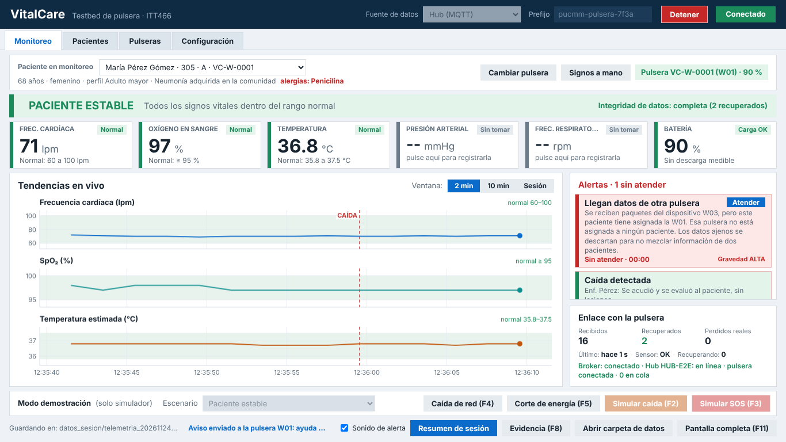

# VitalCare Web

La estación de monitoreo de `app_testbed.py` llevada al navegador. Hace lo mismo que la versión de
escritorio y se ve igual: las cuatro pestañas, los seis signos, las alertas con su formulario de
atención, los perfiles clínicos por edad y sexo, el cambio de pulsera, la auditoría, la caída de red
(F4), el corte de energía (F5) y la evidencia (F8).

Publicada en https://vitalcare-pulsera.vercel.app. Se abre en Google Chrome o Microsoft Edge.



## Fuentes de datos

| Fuente | Para qué |
|---|---|
| **Simulador** | Demostración sin hardware, con los mismos ocho escenarios del escritorio |
| **Bluetooth (BLE)** | La PC se conecta directo a la pulsera (Chrome o Edge en Windows, Bluetooth encendido) |
| **Hub (MQTT)** | La pulsera real a través del hub y el broker. Funciona desde cualquier PC con internet |

La fuente WiFi/UDP del escritorio no existe aquí porque un navegador no puede abrir puertos UDP.

## Dónde quedan los datos

En el escritorio, los datos viven en `vitalcare.db` y en la carpeta `datos_sesion/`. En la web
viven dentro del navegador de esa computadora (IndexedDB):

- La base de datos es el **mismo `vitalcare.db`** del escritorio, con las mismas tablas. Se exporta
  y se importa desde *Configuración → Datos del navegador*.
- Cada fila de telemetría, eventos, alertas y huecos se guarda en el momento en que llega. Los
  archivos de cada sesión se descargan desde *Abrir carpeta de datos*.
- No se pierde nada al recargar ni al cerrar. Si la página se cierra de golpe (se va la luz, se
  mata el navegador), al volver a abrirla avisa del corte igual que el escritorio.
- Los datos **no viajan solos** a otra computadora ni a otro navegador. Para pasarlos, exportar la
  base en una y importarla en la otra.
- Solo se puede tener una pestaña de VitalCare abierta a la vez, para que dos pestañas no escriban
  la misma base.

## Probarla en tu PC sin subirla

Desde esta carpeta:

```
python -m http.server 8000
```

y abrir http://localhost:8000. Para probar la fuente Hub sin la pulsera, en otra terminal:

```
pip install paho-mqtt
python ../emisor_mqtt_prueba.py
```

## Pruebas automáticas

Las mismas 32 de `pruebas_testbed.py`, traducidas. Las dos de WiFi/UDP se cambiaron por dos de la
fuente Hub (MQTT) con un broker de mentira.

- En el navegador: abrir `/pruebas/` (por ejemplo https://vitalcare-pulsera.vercel.app/pruebas/).
  Debe decir `32 de 32 pruebas correctas`. No toca los datos guardados de la estación.
- Con Node: `node pruebas/correr_node.mjs` corre las 30 que no necesitan ventana.

## Archivos

| Archivo | Equivale a | Qué hace |
|---|---|---|
| `index.html`, `estilo.css` | `estilo.py` | Página y estilos (mismos colores y medidas) |
| `js/app.js` | `app_testbed.py` | Ventana principal y pestaña de monitoreo |
| `js/pantallas.js` | `pantallas.py` | Pacientes, pulseras y configuración, con sus formularios |
| `js/datos.js` | `datos.py` | Base de datos SQLite (mismo esquema y mismas consultas) |
| `js/logica.js` | `logica.py` | Clasificación de signos, conteo de paquetes y resumen |
| `js/transportes.js` | `transportes.py` | Simulador, Bluetooth y hub por MQTT |
| `js/registro.js` | `registro.py` | Archivos CSV de la sesión |
| `js/graficas.js` | matplotlib | Las tres gráficas de tendencias |
| `js/almacen.js` | el disco | Guarda la base y los archivos en el navegador |
| `js/ui.js` | `estilo.py` | Botones, tablas y diálogos compartidos |
| `vendor/` | | sql.js (SQLite), mqtt.js y html2canvas, copiados aquí para no depender de internet |
| `pruebas/` | `pruebas_testbed.py` | Pruebas automáticas |

Si se cambia una regla clínica o de datos en el escritorio, hay que cambiarla también aquí: cada
archivo de `js/` dice al principio de cuál archivo de Python es la traducción.
